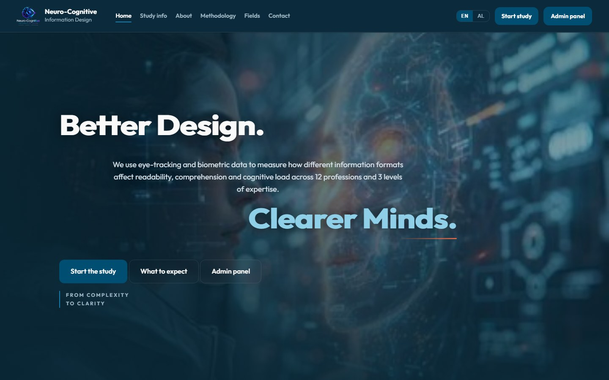
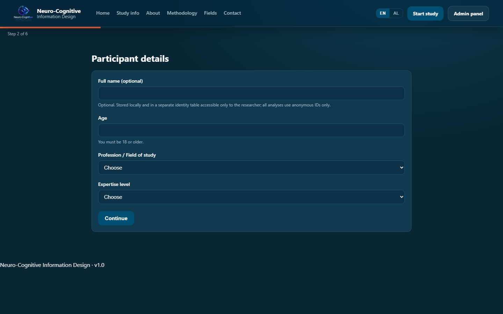
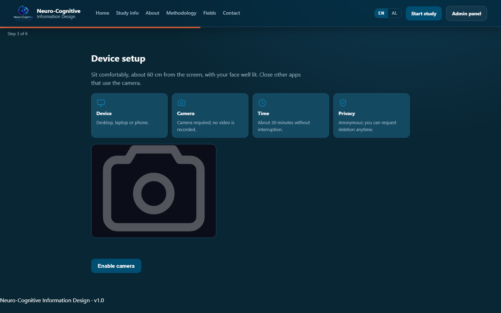
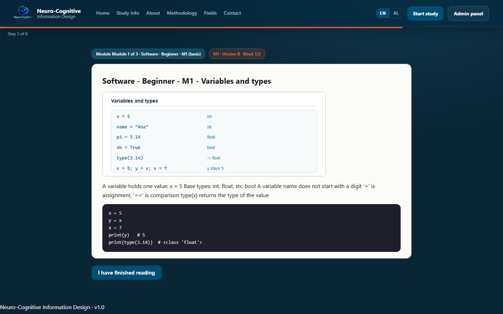
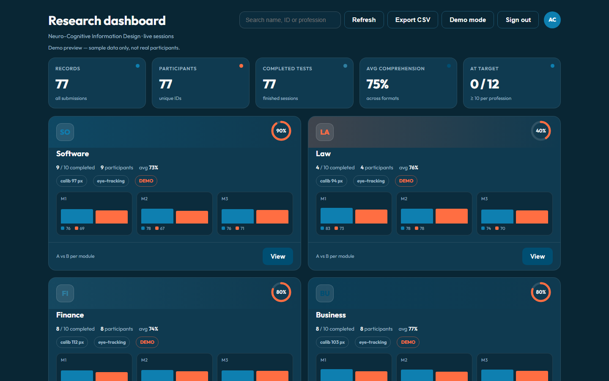
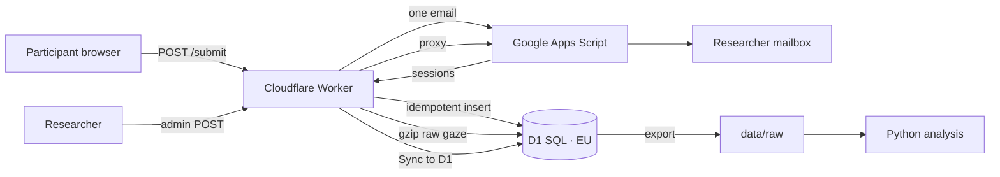

<div align="center">


# Neuro-Cognitive Information Design

**How does layout change what the mind understands?**  
An eye-tracking and biometric study across **12 professions**, **3 expertise levels**, and **108 modules** — with a free, live, reproducible data pipeline.

[](https://arditceno.github.io/Neuro-Cognitive-Information-Design/)
[](https://ncid-api.ncid-study.workers.dev/health)
[](QUALITY.md)

[](https://github.com/ArditCeno/Neuro-Cognitive-Information-Design/actions/workflows/ci.yml)
[](https://github.com/ArditCeno/Neuro-Cognitive-Information-Design/actions/workflows/deploy-pages.yml)
[](https://github.com/ArditCeno/Neuro-Cognitive-Information-Design/actions/workflows/monitor.yml)

[](https://developer.mozilla.org/docs/Web/HTML)
[](https://developer.mozilla.org/docs/Web/JavaScript)
[](https://workers.cloudflare.com)
[](https://developers.cloudflare.com/d1/)
[](https://developers.google.com/apps-script)
[](https://www.python.org)
[](LICENSE)

</div>

---

## Table of contents

- [At a glance](#at-a-glance)
- [Gallery](#gallery)
- [The study in one paragraph](#the-study-in-one-paragraph)
- [The 12 professions](#the-12-professions)
- [How a session works](#how-a-session-works)
- [Architecture](#architecture)
- [One email, guaranteed](#one-email-guaranteed)
- [Quick start](#quick-start-local)
- [Researcher dashboard](#researcher-dashboard)
- [Live data pipeline](#live-data-pipeline)
- [Email delivery](#email-delivery)
- [Conference materials](#conference-materials)
- [Data and privacy](#data-and-privacy)
- [Backfill and export](#backfill-and-export)
- [Project layout](#project-layout)
- [Documentation](#documentation)
- [Testing](#testing)
- [Deployment](#deployment)
- [Security](#security)
- [Analysis (Python)](#analysis-python)
- [Roadmap](#roadmap)
- [Cite this work](#cite-this-work)
- [Contact](#contact)

---

## At a glance

| | |
|---|---|
| **Design** | Within-subjects, counterbalanced A/B, separate quiz per format |
| **Professions** | 12 · 3 expertise levels · 3 modules each |
| **Materials** | 108 modules · 432 documents (A/B × EN/AL) · 648 quiz items |
| **Session** | Consent → setup → 1/1 calibration → 3 modules → TLX → report |
| **Duration** | About 30 minutes |
| **Eye tracking** | WebGazer + MediaPipe FaceMesh (blink and head pose) |
| **Data** | Cloudflare D1 (SQL, EU) + compressed gaze; Apps Script email |
| **Guarantee** | One report per participant; retries never send a second email |
| **Cost** | 0 — GitHub Pages, Workers, D1, Apps Script free tiers |
| **Quality** | [8.9 / 10](QUALITY.md) · 2,631 + 379 + 111 + 6 + 16 + 88 checks |

---

## Gallery

<table>
  <tr>
    <td width="50%"></td>
    <td width="50%"></td>
  </tr>
  <tr>
    <td align="center"><sub>Landing page</sub></td>
    <td align="center"><sub>Participant registration</sub></td>
  </tr>
  <tr>
    <td width="50%"></td>
    <td width="50%"></td>
  </tr>
  <tr>
    <td align="center"><sub>Camera setup and calibration</sub></td>
    <td align="center"><sub>Reading task (structured vs. compressed)</sub></td>
  </tr>
  <tr>
    <td colspan="2"></td>
  </tr>
  <tr>
    <td colspan="2" align="center"><sub>Researcher dashboard: 12 professions, A vs. B per module, live delivery</sub></td>
  </tr>
</table>

---

## The study in one paragraph

Each participant picks a profession and an expertise level, then reads the **same content in two layouts**: a **structured** version (clear hierarchy, generous spacing) and a **compressed** version (denser page). While they read, the study records **where they look** and **how well they understand**. No video is recorded or stored.

**Measured:** fixation duration (ms), saccadic regressions, time to first fixation (ms), comprehension accuracy (%), reading and task time (s), NASA-TLX workload, plus blink rate and head orientation (exploratory).

**Design:** within-subjects, **counterbalanced A/B** (session-parity rotation), a **separate quiz for each format**, and **NASA-TLX after every module**.

---

## The 12 professions

Law · Medicine · Nursing · Electrical engineering · Software · Biology · Chemistry · Pedagogy · Finance · Business · Culinary · Biotechnology

Each profession has **3 levels** (beginner, intermediate, advanced) and **3 modules**, giving **108 modules** in both **A and B**, in **EN and AL**, with **648 quiz items**.

---

## How a session works

```text
Consent
  → Participant details
  → Camera check
  → 1/1 nine-point calibration
  → Read module 1 (A/B) → quiz → preference → NASA-TLX
  → Read module 2 (A/B) → quiz → preference → NASA-TLX
  → Read module 3 (A/B) → quiz → preference → NASA-TLX
  → Done: one report, stored once, emailed once
```

The camera is **required** for eye tracking. The study runs in the browser, on desktop or phone (Chrome, Edge or Safari), and needs about **30 minutes**.

---

## Architecture



**Why this shape**

- **One write path.** The browser talks to the Worker; the Worker writes D1 and then triggers email.
- **The database is the source of truth.** Email is a notification, not the only copy.
- **Local analysis stays local.** Export D1/R2 to `data/raw/`; no cloud credentials in Python.
- **Free by design.** GitHub Pages + Workers + D1 + Apps Script, no paid server.

---

## One email, guaranteed

| Layer | Guard |
|---|---|
| Browser | Stable `submission_id`; a sent marker blocks resend; `?force=1` is researcher-only |
| Client queue | Dedupes by `submission_id`; no blind retry after a timeout |
| Database | `submission_id` is the primary key; `id_anonim` is UNIQUE |
| Worker | `INSERT OR IGNORE`; a duplicate returns `{ok:true, duplicate:true}` without email |
| Apps Script | `sent_<submission_id>` and `sent_id_<id_anonim>` markers under `LockService` |
| Email | Exactly one HTML report per participant |

Live proof: the first POST returns `email:"sent"`; the second returns `duplicate:true` and does **not** create a row or send a second email.

---

## Quick start (local)

```bash
npx serve .
```

Open `http://localhost:3000/`. The camera needs `http://` or `https://`, not a local file.

- `study.html?mock=1` — simulated run (no webcam)
- `study.html?calib=1` — calibration only, shows accuracy in pixels
- `study.html?force=1` — researcher override for a deliberate resend
- `admin.html?demo=1` — dashboard preview with sample data (no login, no real data)

Worker development:

```bash
cd worker
npx wrangler dev
npx wrangler d1 migrations apply ncid-db --local
```

---

## Researcher dashboard

Open `/admin.html` and sign in with the owner email, a password, and a **6-digit code sent by email**. The password is sent as a **POST body to the Worker**, not in a JSONP URL.

The dashboard shows:

- **5 stat cards** — records, participants, completed tests, average comprehension, professions at target
- **12 profession cards** (2 columns) with progress rings, participants, average comprehension, **calibration accuracy**, and a **mini A-vs-B chart** per module
- **Detail drawer** — full A-vs-B chart, session table with calibration accuracy, and each participant's answers, NASA-TLX and biometrics. Focus moves into the drawer, Tab is trapped, Escape closes it, and focus returns.
- search by name / ID, CSV export, labelled **demo mode**
- **Sync to D1** — imports every mailbox session into the database, idempotently; synthetic test sessions are skipped

---

## Live data pipeline

Every finished session is:

1. stored once in **Cloudflare D1** (SQL, EU region);
2. given a **compressed raw-gaze blob** in D1 (or R2 when enabled);
3. emailed to the researcher through **Google Apps Script**.

The Worker runs a **Cron Trigger** every 5 minutes and retries pending emails; Apps Script's own `sent_<submission_id>` marker prevents duplicates.

**Free-tier budget**

| Service | Free allowance | Study need |
|---|---|---|
| GitHub Pages | static hosting | ✅ |
| Cloudflare Workers | 100k requests/day | ~1 request per session |
| Cloudflare D1 | 5 GB, 5M reads/day, 100k writes/day | tiny |
| Google Apps Script | ~100 emails/day (consumer) | okay if spread over days |
| R2 (optional) | 10 GB | not required; D1 fallback works |

---

## Email delivery

Every finished session is emailed to `arditceno82@gmail.com` as an HTML table — **one email per participant, at the end**.

The email includes **name and surname, ID, profession, expertise, age**, session data, results per level and version, NASA-TLX, biometrics, and every answer.

Setup: paste [`email-setup/Code.gs`](email-setup/Code.gs) into the Apps Script project, set `ADMIN_PASSWORD` in **Script Properties**, then **Deploy → Manage deployments → Edit → New version → Deploy**. The full steps are in [`DEPLOY.md`](DEPLOY.md).

> Gmail requires a one-time authorization for `GmailApp` (used by the dashboard). Run `readMailbox` once in the editor and **Allow** the Gmail permission.

---

## Conference materials

For **KShSN-UT 2026** (University of Tirana):

- Hub: https://arditceno.github.io/Neuro-Cognitive-Information-Design/conference/
- Extended abstract (A4, 2 pages), poster (A1) and a 10-slide deck (16:9), each with a **Download PDF** button.

---

## Data and privacy

- **D1 (SQL, EU)** stores the anonymised session, module, trial, answer and TLX records.
- **Raw gaze** is stored compressed in D1 (or R2 when enabled).
- **Names** live in a separate, access-restricted `identity` table and in the email; they are **excluded** from the analysis export.
- **No video** is recorded or stored.
- **Deletion** by `id_anonim` removes the session rows, gaze object and email copy; it is logged.
- See [privacy.html](privacy.html), [terms.html](terms.html), [SECURITY.md](SECURITY.md), and [docs/HLD.md](docs/HLD.md).

---

## Backfill and export

**Backfill (one click):** log in to `admin.html` and press **Sync to D1**. It reads the mailbox through Apps Script and imports sessions idempotently. Test IDs are skipped.

**Script alternative:**

```bash
IMPORT_TOKEN=... WORKER_URL=https://ncid-api.ncid-study.workers.dev \
  node scripts/backfill.mjs data/raw/mailbox-sessions.json
```

**Export for analysis:**

```bash
WORKER_URL=https://ncid-api.ncid-study.workers.dev EXPORT_TOKEN=... \
  node scripts/export_d1.mjs

WORKER_URL=https://ncid-api.ncid-study.workers.dev EXPORT_TOKEN=... \
  node scripts/export_r2.mjs
```

- Analysis payloads: `data/raw/session_*.json` (no names)
- Private names: `data/private/identity.json` (gitignored)
- Tokens live in `worker/.env` (gitignored)

---

## Project layout

```text
index.html                landing page (Home)
study.html                participant test (consent → reading → quiz → report)
study-info.html           what to expect, requirements, FAQ
admin.html                researcher dashboard (email + password + code)
privacy.html terms.html   legal pages
about.html methodology.html fields.html contact.html   public pages
404.html                  not-found page

worker/                   Cloudflare Worker (submit, admin proxy, import/export, cron)
sql/0001_init.sql         D1 schema, indexes and analysis views
materials/                432 documents (108 modules × A/B × EN/AL)
assets/
  diagrams/               108 on-topic SVG diagrams (one per module)
  photos/                 5 approved real photos + CREDITS.md
  screenshots/            README gallery images
js/                       application, eye-tracking, storage, report, visuals, admin
css/                      landing, header, main, materials, admin
mediapipe/                FaceMesh assets for WebGazer
vendor/                   heatmap.js, jsPDF, emailjs (local copies)
analysis/                 Python: metrics, stats, figures, ncid_admin.py
email-setup/              Google Apps Script: submissions + admin API
conference/               abstract, poster, slides (print-ready)
docs/                     protocol, analysis plan, HLD/LLD, codebook, power, prereg, audit
scripts/                  generators, backfill, export, screenshot capture and tests
supabase/                 legacy optional path (not used by the live site)
```

---

## Documentation

| Document | What it covers |
|---|---|
| [docs/PROTOCOL.md](docs/PROTOCOL.md) | Design, hypotheses, procedure, ethics |
| [docs/ANALYSIS_PLAN.md](docs/ANALYSIS_PLAN.md) | Outcomes, models, multiplicity |
| [docs/HLD.md](docs/HLD.md) | High-level architecture and trust boundaries |
| [docs/LLD.md](docs/LLD.md) | API, schema, idempotency and retry details |
| [docs/CODEBOOK.md](docs/CODEBOOK.md) | Every exported field, unit and SQL mapping |
| [docs/POWER.md](docs/POWER.md) | Sample-size planning (paired approximation: N=80) |
| [docs/PREREGISTRATION.md](docs/PREREGISTRATION.md) | OSF registration template |
| [docs/AUDIT.md](docs/AUDIT.md) | Accessibility, security, pilot and release audit plan |
| [QUALITY.md](QUALITY.md) | Evidence-based scorecard and remaining gaps |
| [ACCESSIBILITY.md](ACCESSIBILITY.md) | Targets, features and known limits |
| [DEPLOY.md](DEPLOY.md) | One-time backend setup and verification |
| [SECURITY.md](SECURITY.md) | 20-point hardening checklist |
| [worker/README.md](worker/README.md) | Worker, D1, R2, secrets, backfill |
| [assets/photos/CREDITS.md](assets/photos/CREDITS.md) | Photo licences and authors |

---

## Testing

```bash
npm test                         # all local checks below (no install needed)
node scripts/test-all.mjs        # structure, materials, config, one-email guards
node scripts/test-links.mjs      # local links, ids, alt text, EN/AL pairing
node scripts/test-seo.mjs        # canonical, OG, manifest, sitemap, security.txt
node scripts/test-aoi.mjs        # fixation/AOI unit checks
node scripts/test-worker.mjs     # Worker validation, caps and email parsing
node scripts/test-report.mjs     # end-to-end report with a named participant
node scripts/test-endpoint.mjs   # live Apps Script admin/submission API
node scripts/test-send.mjs desktop   # send a real test submission (or: phone)
node scripts/capture-screenshots.mjs # regenerate the README gallery
python -m unittest discover -s analysis -p "test_*.py"  # analysis unit tests
```

**Current status:** **2,631 + 379 + 111 + 6 + 16 + 88** checks passing — including one-email idempotency, calibration (1/1), link/HTML, SEO/PWA, AOI, Worker and live API checks. CI, Pages deploy and the uptime monitor are green.

---

## Deployment

### GitHub Pages

- Source: **GitHub Actions** in Settings → Pages.
- `.github/workflows/deploy-pages.yml` publishes on every push to `main`.
- The repository is public on a free account; no build step is required.

### Worker + D1

```bash
cd worker
npx wrangler login
npx wrangler d1 create ncid-db
# paste database_id into worker/wrangler.toml
npx wrangler d1 migrations apply ncid-db --remote
npx wrangler secret put IMPORT_TOKEN
npx wrangler secret put EXPORT_TOKEN
npx wrangler deploy
```

Set `storage.submission.url` in `js/config.js` to the Worker `/submit` URL.

### Apps Script

Paste [`email-setup/Code.gs`](email-setup/Code.gs), set `ADMIN_PASSWORD`, and deploy a new version. No submission token is used; dedupe is server-side.

---

## Security

- **Admin:** password in a POST body to the Worker (never a JSONP URL), then a 6-digit email code; codes expire and are rate-limited.
- **Worker:** CORS allowlist, payload size cap, gaze sample cap, bound SQL parameters, token-protected `/import` and `/export/*`.
- **Database:** D1 and R2 are not publicly addressable; only the Worker writes.
- **Names:** separate `identity` table; excluded from analysis exports.
- **GitHub:** `main` protected (force-push and deletion blocked, required checks), secret scanning + push protection, Dependabot alerts and automated fixes.
- **Repository:** no database service keys or admin password in the tree; local secrets live in gitignored `worker/.env`.
- **Fail closed:** if R2 is absent, gaze is stored in D1; if email fails, the Cron retries; if the Worker is down, the client queue keeps the report.

See [SECURITY.md](SECURITY.md) for the full checklist and known limits.

---

## Analysis (Python)

```bash
python -m pip install -r analysis/requirements.txt

# Export from D1/R2 first (see above), then:
python analysis/clean.py --input data/raw --output analysis/data/processed
python analysis/metrics.py
python analysis/stats.py
python analysis/figures.py

# Mailbox admin report (searchable by name / ID)
python analysis/ncid_admin.py --user arditceno82@gmail.com --find "Ardit"
```

The analysis export contains the anonymous ID and measurements only; names stay in `data/private/`.

---

## Roadmap

| Priority | Item | Status |
|---|---|---|
| 1 | One-click backfill from the mailbox | **Built**; run it from the admin panel |
| 2 | External WCAG 2.2 AA + security audit | Planned — [docs/AUDIT.md](docs/AUDIT.md) |
| 3 | Pilot 5–8 participants + SUS | Planned |
| 4 | Ethics approval + OSF pre-registration | Template ready — [docs/PREREGISTRATION.md](docs/PREREGISTRATION.md) |
| 5 | R2 for raw gaze (optional) | Ready; enable the binding and redeploy |
| 6 | Playwright + axe + Lighthouse CI | Planned |
| 7 | CSS token consolidation | Known debt — see [QUALITY.md](QUALITY.md) |

---

## Cite this work

If you use this instrument or its materials, cite it as:

> Ceno, A. (2026). *Neuro-Cognitive Information Design: an eye-tracking study of document readability*. https://arditceno.github.io/Neuro-Cognitive-Information-Design/

Machine-readable citation: [`CITATION.cff`](CITATION.cff).

---

## Contact

**Ardit Ceno** · [arditceno82@gmail.com](mailto:arditceno82@gmail.com) · [LinkedIn](https://www.linkedin.com/in/ardit-ceno-a674b5307/)

---

<div align="center">

**Copyright 2026 Ardit Ceno. All rights reserved.**

<sub>Built for KShSN-UT 2026 · University of Tirana</sub>

</div>
